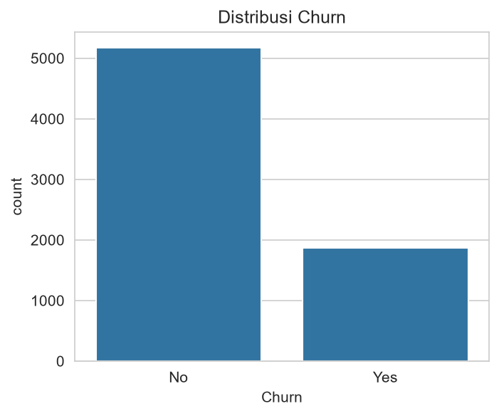
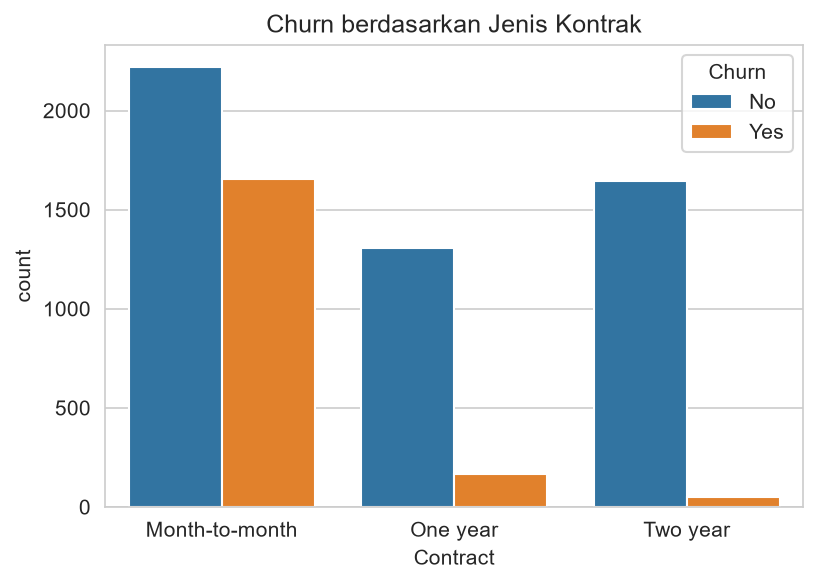
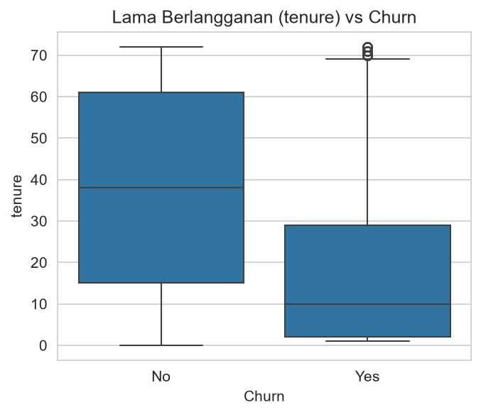

# Prediksi Churn Pelanggan Telco

**Tugas Mata Kuliah Machine Learning**

| Data  | Keterangan                       |
| ----- | -------------------------------- |
| Nama  | Rizky Koto                       |
| NIM   | 231011400407                     |
| Kelas | 05TPLP018                        |
| Dosen | Asep Erlan Maulana S.Kom., M.Kom |

## Dataset

- Sumber: Kaggle - Telco Customer Churn (BlastChar)
- Jumlah data: 7.043 baris, 21 kolom
- Target: Churn (Yes/No)

## Temuan EDA

- Tidak ada missing value pada pengecekan awal.
- Kolom TotalCharges terbaca sebagai teks, sehingga dikonversi ke angka.
- Setelah dikonversi, ada 11 nilai kosong pada TotalCharges. Semuanya berasal dari pelanggan dengan tenure = 0 (pelanggan baru yang belum ditagih), lalu diatasi dengan imputasi.
- Proporsi churn: No 73,46% dan Yes 26,54%, artinya data tidak seimbang.

## Visualisasi EDA

- Pelanggan dengan kontrak Month-to-month paling banyak churn.
- Pelanggan yang churn cenderung memiliki tenure (lama berlangganan) lebih pendek.

## Pemodelan

- Preprocessing: imputasi median + standarisasi untuk kolom angka, one-hot encoding untuk kolom kategori.
- Pembagian data: 80% latih (5634 baris), 20% uji (1409 baris), dengan stratifikasi.
- Penanganan data tidak seimbang: class_weight="balanced".

## Hasil Evaluasi

| Model               | Accuracy | Precision (churn) | Recall (churn) | F1-score (churn) |
| ------------------- | -------- | ----------------- | -------------- | ---------------- |
| Logistic Regression | 0.738    | 0.50              | 0.78           | 0.614            |
| Random Forest       | 0.764    | 0.55              | 0.62           | 0.582            |

Model terbaik: **Logistic Regression**, dipilih berdasarkan F1-score pada kelas churn.

Catatan: Random Forest punya accuracy sedikit lebih tinggi, tetapi Logistic Regression lebih baik dalam mendeteksi pelanggan yang churn (recall 0.78 vs 0.62). Untuk kasus churn, mendeteksi pelanggan yang akan pergi lebih penting daripada accuracy keseluruhan, jadi F1 dan recall dijadikan acuan.

## Aplikasi Prediksi

Aplikasi web dibuat dengan Streamlit. Pengguna mengisi data pelanggan, lalu aplikasi menampilkan prediksi churn beserta probabilitasnya.

Menjalankan secara lokal:

    pip install -r requirements.txt
    streamlit run app.py
